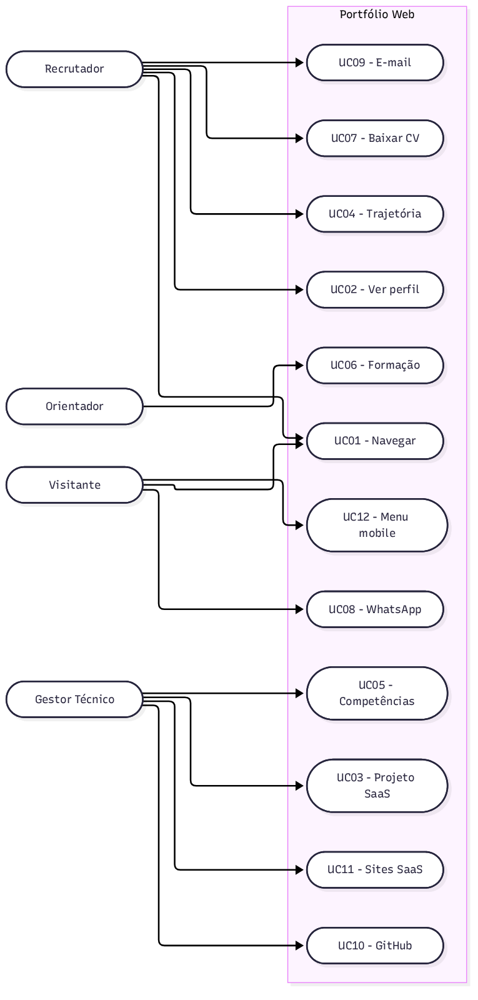
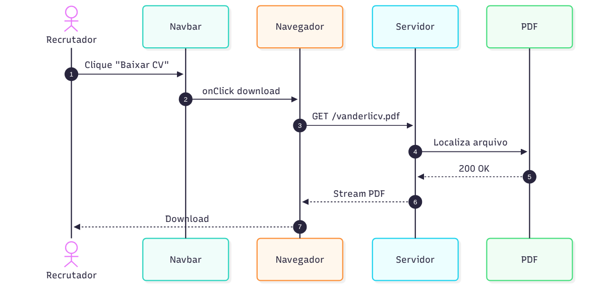
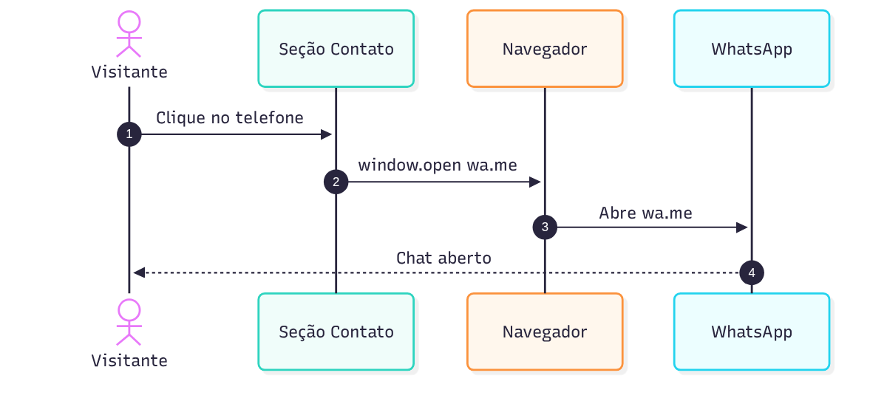

# Portfólio Profissional Web — Vanderli Marques dos Reis


Bem-vindo ao repositório do meu Portfólio Profissional Web. Esta é uma Single Page Application (SPA) desenvolvida em React e compilada via Vite, projetada para apresentar minha trajetória profissional, competências técnicas, projetos em destaque (como a plataforma SaaS RoboCV/CentronicTec) e como entrar em contato comigo.

## 🎓 Identificação Acadêmica

| Atributo | Informação |
|---|---|
| **Instituição de Ensino** | SENAC — CEP Jó Rufino |
| **Curso** | Técnico em Desenvolvimento de Sistemas |
| **Disciplina / Projeto** | Sistema Web TI Centronictec |
| **Orientador** | Hudson Neves |
| **Aluno** | Vanderli Marques dos Reis |
| **Local & Ambiente** | Taguatinga Norte — Oracle Cloud Infrastructure (OCI) |

---

## 📑 Sumário

- [Sobre o Projeto](#sobre-o-projeto)
- [Documentação Técnica (SRS)](#documentação-técnica-srs)
- [Diagramas UML (Casos de Uso)](#diagramas-uml-casos-de-uso)
- [Tecnologias Utilizadas](#tecnologias-utilizadas)
- [Como Executar o Projeto](#como-executar-o-projeto)
- [Estrutura do Repositório](#estrutura-do-repositório)
- [Contato](#contato)

---

## Sobre o Projeto

O objetivo deste portfólio é centralizar e apresentar de forma moderna e responsiva toda a minha experiência em infraestrutura de TI, transição para arquitetura de soluções em nuvem e desenvolvimento de produtos SaaS. O site é dividido nas seguintes seções:

1. **Hero:** Apresentação inicial com links rápidos para contato e download do CV.
2. **Grid de Tecnologias:** Logos de empresas e stacks com as quais já trabalhei.
3. **Perfil Profissional:** Resumo da trajetória e foco atual.
4. **Projeto em Destaque (SaaS):** Detalhes sobre a plataforma de atendimento virtual omnichannel (RoboCV).
5. **Experiência Profissional:** Linha do tempo com 10 experiências desde 2001.
6. **Competências Técnicas:** Categorizadas em Cloud, Dev, Banco de Dados e DevOps.
7. **Formação e Qualificações:** Graduação, certificações (Six Sigma, Kanban, Cisco) e CNH.
8. **Contato:** Links diretos para e-mail e WhatsApp.

---

## Documentação Técnica (SRS)

Para garantir a qualidade e a manutenibilidade do software, foi elaborada uma **Especificação de Requisitos de Software (SRS)** seguindo o padrão IEEE 830-1998 e as diretrizes do Rational Unified Process (RUP).

- 📄 **[Baixar a SRS completa em PDF](./docs.esp.software/ESRS-Portifolio-VanderliReis.pdf)**

---

## Diagramas UML (Casos de Uso)

Abaixo estão os diagramas que modelam as interações dos usuários com o Portfólio. A especificação detalhada de cada caso de uso (fluxos principal e alternativo) está na Seção 5 do documento SRS.

### 1. Diagrama Geral de Casos de Uso

Este diagrama mapeia como diferentes atores (Recrutador, Gestor Técnico, Visitante, Orientador) interagem com as funcionalidades do portfólio.



### 2. Diagrama de Sequência — UC07 (Baixar Currículo)

Fluxo de interação para o download do currículo em PDF.



### 3. Diagrama de Sequência — UC08 (Contato via WhatsApp)

Fluxo de interação para abertura do WhatsApp via link `wa.me`.



---

## Tecnologias Utilizadas

O projeto foi construído utilizando as seguintes ferramentas e bibliotecas:

| Categoria | Tecnologias |
|---|---|
| **Frontend** | React 18, Vite |
| **Estilização** | Tailwind CSS, PostCSS |
| **Ícones** | Lucide React |
| **Linguagem** | JavaScript (ES6+), JSX |
| **Documentação** | Pandoc (Markdown para PDF), XeLaTeX, Mermaid (UML) |

---

## Como Executar o Projeto

Para rodar este projeto localmente, você precisa ter o **Node.js** (v18+) e o **npm** instalados.

1. Clone o repositório:

```bash
git clone https://github.com/vanderlinuxcode/portifoliov.git
cd portifoliov
```

2. Instale as dependências:

```bash
npm install
```

3. Inicie o servidor de desenvolvimento:

```bash
npm run dev
```

4. Para gerar a versão de produção:

```bash
npm run build
```

---

## Estrutura do Repositório

```text
portifoliov/
├── docs.esp.software/         # Documentação Técnica (SRS e Diagramas)
│   ├── diagramas/             # Diagramas UML (.png e fontes .mmd)
│   └── ESRS-Portifolio-VanderliReis.pdf
├── public/                    # Arquivos estáticos (logos, currículo em PDF)
├── src/                       # Código-fonte React (App.jsx, main.jsx, index.css)
├── README.md                  # Este arquivo
├── package.json               # Dependências do Node
├── tailwind.config.js         # Configuração do Tailwind
└── vite.config.js             # Configuração do Vite
```

---

## Contato

- **Autor:** Vanderli Marques dos Reis
- **E-mail:** [vanderlitecnologia@gmail.com](mailto:vanderlitecnologia@gmail.com)
- **WhatsApp:** [(61) 98651-6466](https://wa.me/5561986516466)
- **GitHub:** [github.com/vanderlinuxcode](https://github.com/vanderlinuxcode)
- **Projeto SaaS em Produção:** [www.centronictec.com.br](https://www.centronictec.com.br)

---
<p align="center">
  <i>© 2025-2026 Vanderli Marques dos Reis. Todos os direitos reservados.</i>
</p>
